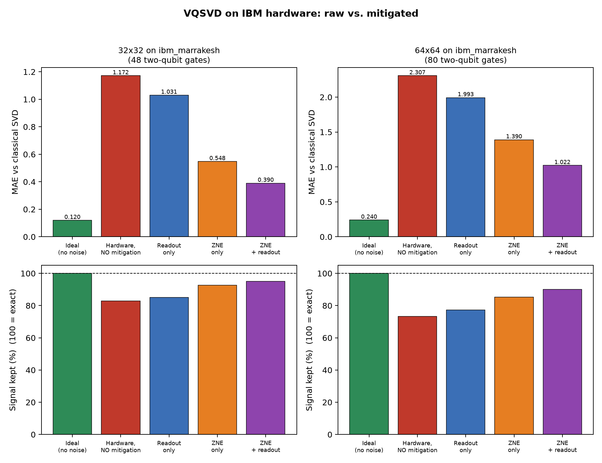

# VQSVD on IBM Quantum hardware: without vs. with error mitigation

Generated 2026-10-15T00:40:38

## Summary

| Matrix | Mitigation | MAE without (raw) | MAE with | Change |
|---|---|---|---|---|
| 32x32 | Readout only | 1.1719 | 1.0307 | 12.1% better |
| 32x32 | ZNE only | 1.1719 | 0.5481 | 53.2% better |
| 32x32 | ZNE + readout | 1.1719 | 0.3902 | 66.7% better |
| 64x64 | Readout only | 2.3072 | 1.9933 | 13.6% better |
| 64x64 | ZNE only | 2.3072 | 1.3903 | 39.7% better |
| 64x64 | ZNE + readout | 2.3072 | 1.0222 | 55.7% better |

MAE = mean absolute error of the extracted singular values vs. classical SVD (lower is better).

## 32x32 (chain ansatz, 5 qubits)

- Backend: **ibm_marrakesh**, physical qubits [13, 12, 11, 10, 9], 2026-10-14T23:55:23
- Transpiled circuit: depth 109, **48 two-qubit gates** (native CNOTs 48); optimization level 3
- Device error rates used: median 2-qubit gate 0.170%, median readout 2.112%
- Shots 4000, ZNE scales [1, 3], mitigation mode `custom`
- Time: classical SVD 0.1007 ms vs hardware evaluation 797.3 s wall-clock, 19.0 s QPU
- Jobs: readout calibration: `db7si56il99s73fopscg`, ZNE scales [1, 3]: `db7si5gr1c5c738l7iq0`

| Condition | sigma[0] | sigma[1] | sigma[2] | MAE vs classical | MAE vs ideal | Signal kept |
|---|---|---|---|---|---|---|
| Classical SVD | 15.5604 | 12.5253 | 11.4517 | - | - | - |
| Ideal (no noise) | 15.5583 | 12.5091 | 11.1098 | 0.1201 | 0.0000 | 100.0% |
| Hardware, NO mitigation | 14.1475 | 11.4406 | 10.4336 | 1.1719 | 1.0518 | 82.9% |
| Readout only | 14.3619 | 11.5582 | 10.5254 | 1.0307 | 0.9106 | 85.1% |
| ZNE only | 15.0558 | 12.1339 | 10.7036 | 0.5481 | 0.4280 | 92.6% |
| ZNE + readout | 15.2980 | 12.2689 | 10.7998 | 0.3902 | 0.2701 | 95.1% |

> **Result:** best mitigation was *ZNE + readout*: MAE 1.1719 -> 0.3902 (improved by 66.7%).

## 64x64 (chain ansatz, 6 qubits)

- Backend: **ibm_marrakesh**, physical qubits [74, 75, 59, 55, 54, 53], 2026-10-15T00:31:16
- Transpiled circuit: depth 144, **80 two-qubit gates** (native CNOTs 80); optimization level 3
- Device error rates used: median 2-qubit gate 0.179%, median readout 1.843%
- Shots 4000, ZNE scales [1, 3], mitigation mode `custom`
- Time: classical SVD 3.4158 ms vs hardware evaluation 645.9 s wall-clock, 19.0 s QPU
- Jobs: readout calibration: `db7t2vmil99s73foqtbg`, ZNE scales [1, 3]: `db7t2vqraffc73fb86ig`

| Condition | sigma[0] | sigma[1] | sigma[2] | MAE vs classical | MAE vs ideal | Signal kept |
|---|---|---|---|---|---|---|
| Classical SVD | 19.0219 | 16.0712 | 15.5505 | - | - | - |
| Ideal (no noise) | 19.0185 | 16.0437 | 14.8607 | 0.2403 | 0.0000 | 100.0% |
| Hardware, NO mitigation | 16.1694 | 14.2078 | 13.3447 | 2.3072 | 2.0670 | 73.3% |
| Readout only | 16.5794 | 14.5033 | 13.5812 | 1.9933 | 1.7530 | 77.4% |
| ZNE only | 17.3373 | 15.0892 | 14.0464 | 1.3903 | 1.1500 | 85.3% |
| ZNE + readout | 17.8175 | 15.4378 | 14.3220 | 1.0222 | 0.7819 | 90.1% |

> **Result:** best mitigation was *ZNE + readout*: MAE 2.3072 -> 1.0222 (improved by 55.7%).

